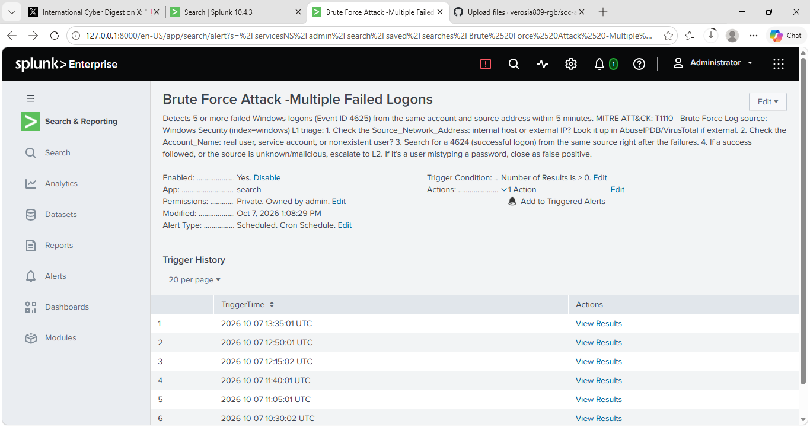

# Detection: Brute Force Attack - Multiple Failed Logons

**MITRE ATT&CK:** T1110 (Brute Force)
**Severity:** High
**Log source:** Windows Security, Event ID 4625 / 4624

## Why High
1. Credential access is the first step to compromise. Repeated failed logons are often how an attacker tries to get a foothold, so reviewing them quickly matters.
2. A success changes everything. If a 4624 follows the failures, the attacker is already in, and the time between the two events is short. Rating it High means it gets looked at before that happens.

## What I did
Failed a Windows logon 5 times on my lab host.

## Detection SPL
```
index=windows EventCode=4625
| bin _time span=5m
| stats count by _time, Account_Name, Source_Network_Address
| where count >= 5
```

## Alert settings
Scheduled every 5 minutes, trigger once when results > 0, throttled 30 minutes per source.

## L1 triage steps
1. Check the source address: internal or external? Look it up if external.
2. Check the account: real user, service account or nonexistent?
3. Search for a successful logon (4624) from the same source afterwards.
4. Escalate to L2 if a success followed or the source is suspicious; close as false positive if it's a user mistyping.
## Result
I failed a Windows logon 5+ times on my lab host. The alert triggered within the 5-minute schedule and appeared in Triggered Alerts (High).



**Tuning:** The alert initially re-fired on old failed logons. I narrowed the search window to the last 15 minutes and set triggered alerts to expire after 24 hours.
