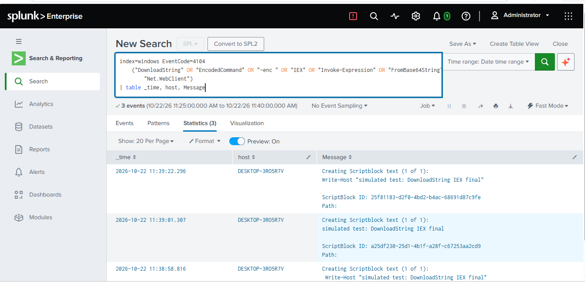
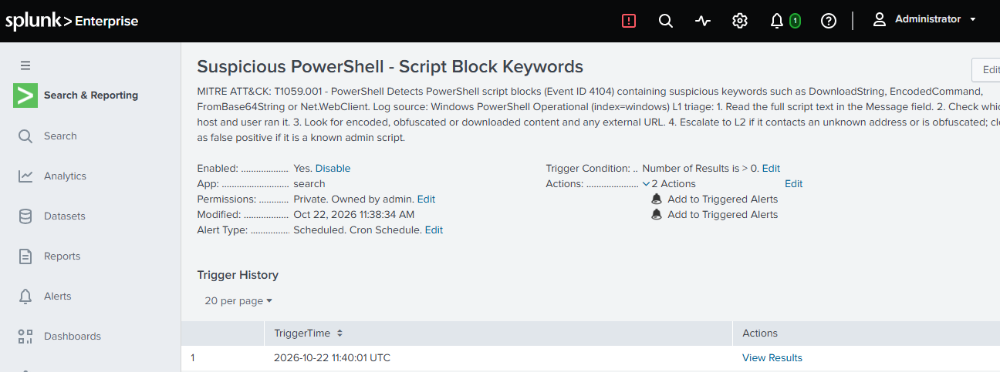

# Detection: Suspicious PowerShell - Script Block Keywords

**MITRE ATT&CK:** T1059.001 (PowerShell)

**Severity:** High

**Log source:** Windows PowerShell Operational log, Event ID 4104 (Script Block Logging)

## Why High
1. Keywords like `DownloadString`, `EncodedCommand` and `FromBase64String` are classic signs of malware downloading or hiding code, so the alert needs fast review.
2. PowerShell runs with the user's privileges and leaves little on disk, so an attacker who gets this far can move quickly.
3. In production I would start at Medium and raise to High when the script contacts an unknown URL or is obfuscated, since legitimate admin scripts can also use these keywords.

## What I did
Enabled PowerShell Script Block Logging and ran a harmless command containing the keywords `DownloadString IEX` in Windows PowerShell 5.1.

## Detection SPL
```
index=windows EventCode=4104
    ("DownloadString" OR "EncodedCommand" OR "FromBase64String" OR "Net.WebClient" OR "-enc ")
| table _time, host, Message
```

## Alert settings
Scheduled every 5 minutes, searching the last 15 minutes, trigger once when results > 0, throttled 30 minutes, expires after 24 hours, action: Add to Triggered Alerts.

## L1 triage steps
1. Read the full script text in the Message field.
2. Check which host and user ran it.
3. Look for encoded, obfuscated or downloaded content and any external URL.
4. Escalate to L2 if it contacts an unknown address or is obfuscated; close as false positive if it is a known admin script.

## Tuning and coverage notes
- The alert first fired on a built-in Windows troubleshooting script, so I removed the broad keywords `IEX` and `Invoke-Expression`.
- Early tests did not appear because I was using PowerShell 7, which logs to a different channel than the one my forwarder collects. Testing in Windows PowerShell 5.1 fixed it.
- The alert matched events but logged no triggers because no "Add to Triggered Alerts" action was configured. The scheduler log showed `result_count = 1` with an empty `alert_actions` field, which is how I found it.
- Without throttling, one event triggered the alert on every run until it left the 15-minute window. I added a 30-minute throttle.

## Result
My test command was captured as Event 4104 and the alert triggered.



